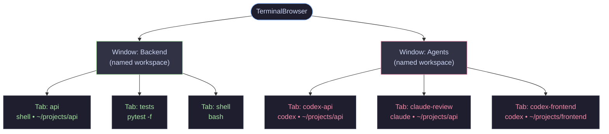

# TerminalBrowser

> A browser for your terminal — not the web.

You already know how to use a browser: open tabs, name your windows, switch between sessions, search across everything, and nothing disappears when you close it. TerminalBrowser brings that exact mental model to your terminal work.

Each tab is a live shell. Each window is a named workspace. Sessions survive restarts via tmux — invisibly, with no tmux knowledge needed. It’s the browser UX you’re already fluent in, applied to the terminal you actually live in.

## How it’s structured



Each **Window** is a named group (like a browser window). Each **Tab** is a live terminal shell backed by tmux — close the app, reopen it, everything is still running.

## Features

- **Named windows** — group terminals by project or context, just like browser windows
- **Directory-backed tabs** — every tab opens in a specific path, like a bookmark that runs
- **Persistent sessions** — close the app, reopen it, your tabs are all still there
- **Side pane** — search, filter, multi-select, pause, resume, kill tabs (`F9` to toggle)
- **Command palette** — keyboard-first access to all actions (`Ctrl+Shift+P`)
- **Themes** — built-in light/dark themes with density control
- **Workspace recipes** — save and restore a full set of tabs in one click

## Advanced features

### Pause / resume any session
Free up CPU from a runaway agent without killing it. The tmux session keeps existing — just frozen.
```bash
tb pause codex-api          # pause one agent
tb pause --tag ai           # pause all agents
tb resume --tag ai          # resume all at once
tb pause-hot --all          # auto-pause anything using high CPU
```

### Broadcast a command to all agents at once
Send the same text to every tab in a tag group — like texting all your agents simultaneously.
```bash
tb send --tag ai "status"                    # ask all agents for status
tb send --tag ai "stop and summarise"        # graceful checkpoint
tb send --tag ai "continue" --no-enter       # stage input, don't submit yet
```

### Read all agent output without switching tabs
```bash
tb capture --tag ai --lines 200             # last 200 lines from every agent
tb activity --tag ai                        # who needs attention right now?
tb search-output "needs approval" --tag ai  # find specific text across all tabs
```

### Workspace recipes — one command to start everything
```bash
terminalbrowser gui --workspace agents.workspace.json
```
One JSON file defines all windows, tabs, commands, and directories. Reopen any time and everything restores exactly.

### Sessions survive reboots
Close TerminalBrowser, reboot the machine, reopen — all tabs come back. Agents that were mid-task can be resumed exactly where they were.

## Install

```bash
# System dependencies (Ubuntu/Debian)
sudo apt install tmux python3-gi gir1.2-gtk-3.0 gir1.2-vte-2.91

# Install from source
git clone https://github.com/streetquant/TerminalBrowser.git
cd TerminalBrowser
pip install -e .
```

Requires: Python 3.10+, GTK 3, VTE, tmux.

## Run

```bash
termdeck
```

## Keyboard shortcuts

| Action | Key |
|---|---|
| New tab | `Ctrl+Shift+T` |
| Close tab | `Ctrl+Shift+W` |
| Next / prev tab | `Ctrl+Tab` / `Ctrl+Shift+Tab` |
| Toggle side pane | `F9` |
| Command palette | `Ctrl+Shift+P` |
| Settings | `Ctrl+,` |

## Using with Codex / Claude Code

TerminalBrowser shines as a multi-agent cockpit. See **[docs/codex-claude-workflow.md](docs/codex-claude-workflow.md)** for:
- How to launch 3+ agents in parallel with a single workspace recipe
- The agent lifecycle state machine (running → needs input → paused → done)
- The approval loop — click card in side pane, answer, back to work
- CLI commands to monitor, capture output, and steer agents by tag
- Full day workflow Gantt

## License

MIT
