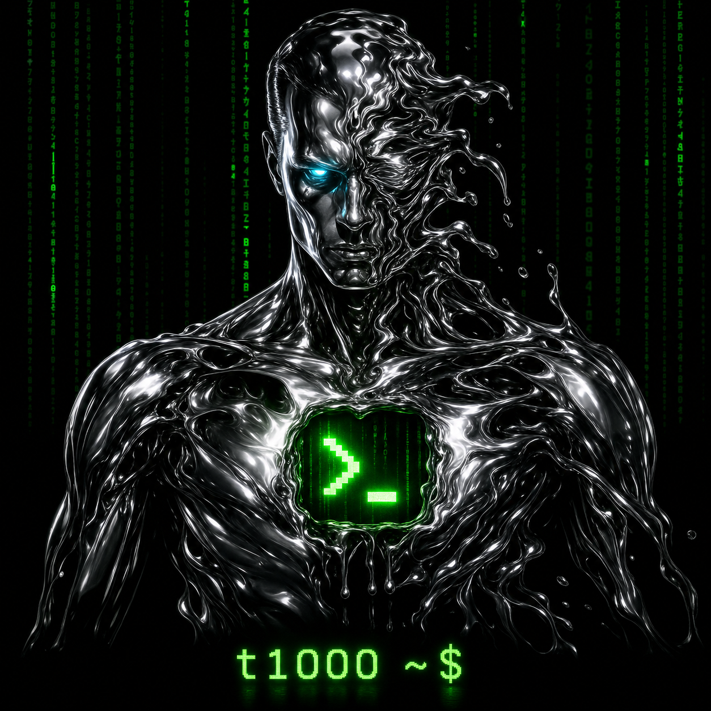
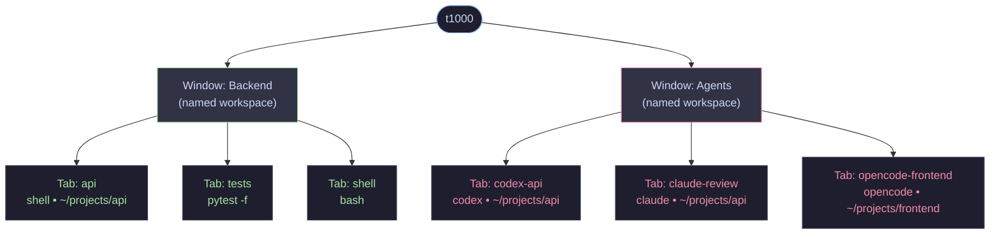

# t1000: Persistent terminal workspaces

<p align="center">
  
</p>

> Named after the T-1000 from *Terminator 2: Judgment Day* — the antagonist that could not be stopped, never crashed, and kept coming back no matter what.

You already know how to use a browser: open tabs, name your windows, switch between sessions, search across everything, and nothing disappears when you close it. t1000 brings that exact mental model to your terminal work.

Each tab is a live shell. Each window is a named workspace. Sessions survive restarts via tmux — invisibly, with no tmux knowledge needed. It's the browser UX you're already fluent in, applied to the terminal you actually live in. And like the machine it's named after: it does not crash, does not lose your work, and keeps running.

## How it's structured

Development work is tracked in BR, with BV for planning. Agents and contributors
should start with [AGENTS.md](AGENTS.md) and the
[BR/BV handoff guide](docs/BEADS_WORKFLOW.md); `todo.md` is retired.



Each **Window** is a named group (like a browser window). Each **Tab** is a live terminal shell backed by tmux — close the app, reopen it, everything is still running.

## Platform support

| OS | Supported | Notes |
|---|---|---|
| **Linux** | ✅ Full | Primary platform. All features work. |
| **macOS** | ⚠️ Partial | GTK3/VTE via Homebrew. `/proc` resource stats unavailable — CPU/RAM monitoring disabled. |
| **Windows** | ⚠️ WSL2 only | Run inside WSL2 (Ubuntu). Native Windows has no GTK3/VTE/tmux. |

## Install

### 🐧 Debian / Ubuntu

```bash
# 1. System dependencies
sudo apt update
sudo apt install -y tmux python3-gi python3-gi-cairo gir1.2-gtk-3.0 gir1.2-vte-2.91 git python3-pip

# 2. Install t1000
git clone https://github.com/streetquant/TerminalBrowser.git
cd TerminalBrowser
pip install -e .

# 3. Run
t1000
```

### 🏹 Arch Linux / Manjaro

```bash
# 1. System dependencies
sudo pacman -S --needed tmux python-gobject gtk3 vte3 git python-pip

# 2. Install t1000
git clone https://github.com/streetquant/TerminalBrowser.git
cd TerminalBrowser
pip install -e . --break-system-packages

# 3. Run
t1000
```

### 🌶️ Fedora / RHEL / CentOS

```bash
# 1. System dependencies
sudo dnf install -y tmux python3-gobject gtk3 vte291 git python3-pip

# 2. Install t1000
git clone https://github.com/streetquant/TerminalBrowser.git
cd TerminalBrowser
pip install -e .

# 3. Run
t1000
```

### 🍎 macOS (partial support)

> ⚠️ Resource monitoring (CPU/RAM per tab) is disabled on macOS — `/proc` is Linux-only.

```bash
# 1. Install Homebrew if not already installed
/bin/bash -c "$(curl -fsSL https://raw.githubusercontent.com/Homebrew/install/HEAD/install.sh)"

# 2. System dependencies
brew install tmux pygobject3 gtk+3 vte3

# 3. Install t1000
git clone https://github.com/streetquant/TerminalBrowser.git
cd TerminalBrowser
pip3 install -e .

# 4. Run (may require XQuartz for display)
t1000
```

### 🪩 Windows (WSL2 only)

> ⚠️ t1000 does not run natively on Windows. Use WSL2 with an Ubuntu distro.

```powershell
# 1. Enable WSL2 and install Ubuntu (PowerShell as Administrator)
wsl --install
# Reboot, then open Ubuntu from Start menu
```

```bash
# 2. Inside Ubuntu WSL2 — same as Debian install above
sudo apt update
sudo apt install -y tmux python3-gi python3-gi-cairo gir1.2-gtk-3.0 gir1.2-vte-2.91 git python3-pip

# For GUI support install a Wayland/X11 compositor (WSLg is built into Win11)
# Win11: WSLg is automatic. Win10: install VcXsrv and set DISPLAY=:0

git clone https://github.com/streetquant/TerminalBrowser.git
cd TerminalBrowser
pip install -e .
t1000
```

## Features

- **Named windows** — group terminals by project or context, just like browser windows
- **Directory-backed tabs** — every tab opens in a specific path, like a bookmark that runs
- **Persistent sessions** — close the app, reopen it, your tabs are all still there
- **Side pane** — ask one window-scoped Codex captain, or multi-select tabs to pause, resume, and kill (`F9` to toggle)
- **Command palette** — keyboard-first access to all actions (`Ctrl+Shift+P`)
- **Themes** — built-in light/dark themes with density control
- **Workspace recipes** — save and restore a full set of tabs in one click

## Advanced features

### Coordinate one window through a Codex captain

Open Codex in a tab, then use the Tabs pane's **Send** composer. The current live Codex tab is adopted as that window's persisted captain on the first send; you can also right-click a tab and choose **Make Codex captain**. Send and Enter submit only to the captain. Checked tabs are never broadcast targets for this composer—selection still belongs to Pause, Resume, Kill, and the secondary bulk actions.

The captain receives a bounded roster of that window's tabs and exact, window-enforced commands for redacted capture, control-plan review, and message delivery. CLI automation can apply the same boundary explicitly:

```bash
t1000 sessions --window-id win-research
t1000 capture td-worker --window-id win-research
t1000 control-plan send td-worker --text "next task" --window-id win-research
t1000 send "next task" --to td-worker --window-id win-research
```

t1000 refuses a captain that is paused, stopped, hidden, in another window, or not currently running Codex. Failed delivery leaves the composer text intact and reports the reason.

### Pause / resume any session
Free up CPU from a runaway agent without killing it. The tmux session keeps existing — just frozen.
```bash
t1000 pause codex-api          # pause one agent
t1000 pause --tag ai           # pause all agents
t1000 resume --tag ai          # resume all at once
t1000 pause-hot --all          # auto-pause anything using high CPU
```

### Broadcast a command to all agents at once
Send the same text to every tab in a tag group — like texting all your agents simultaneously.
```bash
t1000 send --tag ai "status"                    # ask all agents for status
t1000 send --tag ai "stop and summarise"        # graceful checkpoint
t1000 send --tag ai "continue" --no-enter       # stage input, don't submit yet
```

### Read all agent output without switching tabs
```bash
t1000 capture --tag ai --lines 200             # last 200 lines from every agent
t1000 activity --tag ai                        # who needs attention right now?
t1000 search-output "needs approval" --tag ai  # find specific text across all tabs
```

### Workspace recipes — one command to start everything
```bash
t1000 gui --workspace agents.workspace.json
```
One JSON file defines all windows, tabs, commands, and directories. t1000 restores the window and tab layout; process recovery follows the rules below.

### Per-terminal Codex accounts

Terminals with per-tab Codex accounts own a durable private Codex state directory:

```text
~/.local/share/termdeck/terminal-auth/<auth-scope-id>
```

t1000 exports that directory as `CODEX_HOME` only inside the terminal's tmux session. A newly provisioned per-tab account home copies the saved `codex-auth` account catalogue from `~/.codex/accounts`, but never copies the globally active `~/.codex/auth.json`, so it starts with no selected account. Account selection and mutable runtime DB state are separate per terminal. New or empty private scopes link `sessions/` and `archived_sessions/` back to the canonical Codex home so switching accounts cannot hide rollout JSONL. SQLite state remains private per terminal to avoid multi-process lock contention. Before exposing that shared history to a cold private scope, t1000 creates a sparse private database from the currently audited canonical schema and SQLx migration ledger, writes Codex's natural empty complete-backfill marker plus its built-in Pinned section, and leaves conversation tables empty. This prevents each private Codex process from independently scanning the entire shared rollout tree. Immediately before an exact `codex resume <UUID>`, t1000 transactionally hydrates only that UUID's missing thread metadata from a schema-identical canonical `state_5.sqlite`. Existing private databases are never rewritten during scope preparation; an incomplete or running native backfill is left intact, the shared roots are not newly exposed to it, and any new launch or exact hydration fails closed. A non-empty legacy private session tree is preserved in place rather than migrated while it may still belong to a live process.

```bash
# Inside one t1000 terminal; affects only this terminal.
# codex-auth 0.1.x names this operation `use`.
# Open the interactive account picker, then choose with the arrow keys + Enter.
codex-auth use

# Or select a saved account directly by name.
codex-auth use work

# The next Codex process launched in this terminal uses that account.
codex

# Headless inspection or verified switching from outside the terminal.
t1000 auth codex-api
t1000 auth codex-api --switch personal
```

The header account dropdown uses the same verified transaction. t1000 adapts to the installed `codex-auth` layout: 0.1.x uses `use`, a `current` marker, and a private `auth.json` symlink; registry-based releases continue to use their registry metadata. SQLite is updated only after the requested private account verifies. Releases that hard-code `~/.codex` are isolated by a per-terminal compatibility wrapper that changes `HOME` only for the `codex-auth` process; the terminal's ordinary `HOME` is unchanged.

Use the bare `codex-auth use` command for the picker; no empty-string placeholder is required. Account selection changes credentials for subsequent Codex processes in that terminal. It cannot replace credentials already loaded by a running Codex process.

For an explicit GUI account switch, t1000 now makes the new credentials effective immediately. If Codex is running, t1000 first captures its exact `resume <UUID>` identity, recreates only that tmux tab with the selected private auth, verifies the private `CODEX_HOME`/scope/PATH, and resumes the same Codex conversation. If exact recovery cannot be proven, the tab is not killed and its private account is left unchanged. An idle shell already using a private account home needs no restart because its next `codex` launch reads the newly selected credentials. A managed tmux session created before per-tab account support shows an **upgrades terminal** choice: selecting an account recreates it once with the captured live directory and verified idle shell, then enables private account switching. Unknown foreground programs fail closed before credentials or processes change. Adopted external tmux sessions cannot adopt this per-tab account lifecycle in place and must be replaced by a t1000-managed terminal before account switching is enabled.

Account tokens remain in private filesystem state and are never stored in the t1000 SQLite database or browser snapshots. For native 0.1.x catalogs, an existing private scope may import a newer saved snapshot for a non-active account, so a global re-login/re-save can repair stale refresh credentials without overwriting the account currently in use by that tab. Snapshots preserve only the desired account label as pending intent and create a fresh auth scope when imported. Set `TERMDECK_CODEX_ACCOUNT_SOURCE` to use a saved-account source other than `~/.codex`.

Tabs are native terminals running as the host user. Their starting directory does not limit where they can work, and ordinary host filesystem permissions apply. Per-tab homes keep account selection and runtime state separate; processes sharing the host UID can still access each other's files. Browser login, machine enrollment and staged-reference checks continue to authorize TermDeck API operations.

### Exact Codex sessions survive reboots
Foreground Codex tabs persist the primary conversation UUID and reopen directly with `codex resume <UUID>`. The same conversation, working directory, and safe value-free launch flags return in a new operating-system process.

```bash
t1000 checkpoint --all                    # inspect/save exact Codex recovery state
sudo t1000 install-checkpoint-service \
  --system --user max --uid 1000 --home /home/arch
sudo t1000 uninstall-checkpoint-service --system
```

The checkpoint service is system-only and requires `--system`. Installation requires the exact service identity `--user max --uid 1000 --home /home/arch`; other identities are rejected because the shutdown wrapper and systemd ordering are bound to that account. It performs a final exact-UUID scan before the user manager and tmux scopes stop. Ordinary shells and jobs remain alive across t1000 GUI restarts because tmux owns them, but their instruction-level memory is not generically restored after an operating-system reboot. Automatic DMTCP wrapping is disabled: real tmux PTYs exposed application-signal conflicts, fork-path failures, and indefinite drains on external network sockets. Long-running non-Codex work should use its own durable checkpoints and idempotent resume command. A missing uncheckpointed process fails closed as `recovery-pending`; t1000 never silently reruns it from the beginning.

Foreground startup never scans the global Codex rollout archive. Tabs must carry a checkpointed primary conversation UUID before automatic recovery; older rows that contain only `codex --yolo` remain explicit recovery exceptions until a bounded maintenance operation can bind one exact `source="cli"` rollout. t1000 never guesses a conversation, falls back to another workspace, or starts a replacement thread merely to make a pane look healthy.

## Keyboard shortcuts

| Action | Key |
|---|---|
| New tab | `Ctrl+Shift+T` |
| Close tab | `Ctrl+Shift+W` |
| Next / prev tab | `Ctrl+Tab` / `Ctrl+Shift+Tab` |
| Toggle side pane | `F9` |
| Command palette | `Ctrl+Shift+P` |
| Settings | `Ctrl+,` |

## Using with Codex / Claude Code / OpenCode

t1000 shines as a multi-agent cockpit. See **[docs/codex-claude-workflow.md](docs/codex-claude-workflow.md)** for:
- How to launch 3+ agents in parallel with a single workspace recipe
- The agent lifecycle state machine (running → needs input → paused → done)
- The approval loop — click card in side pane, answer, back to work
- CLI commands to monitor, capture output, and steer agents by tag
- Full day workflow Gantt

You can use t1000 with Codex, Claude Code, and OpenCode side by side. Give each agent its own tab or tag, then monitor and steer them from the same workspace.

### Quick install using Codex / Claude Code / OpenCode

Paste this prompt into Codex, Claude Code, or OpenCode and it will install t1000 on your machine:

```
Install t1000 from https://github.com/streetquant/TerminalBrowser by:
1. Installing system dependencies for this OS (tmux, GTK3, VTE, python3-gi)
2. Cloning the repo into ~/t1000
3. Running pip install -e . inside it
4. Verifying with: t1000 --version
```

## License

MIT

## Web deployment and remote access

t1000 includes an authenticated browser terminal with persistent LAN HTTPS/WSS services, a validated `/t1000` reverse-proxy contract, and optional Cloudflare Tunnel exposure. See [docs/termdeck-web-deployment.md](docs/termdeck-web-deployment.md) for the threat model, service topology, dynamic-address certificate handling, deployment contracts, and rollback requirements.
