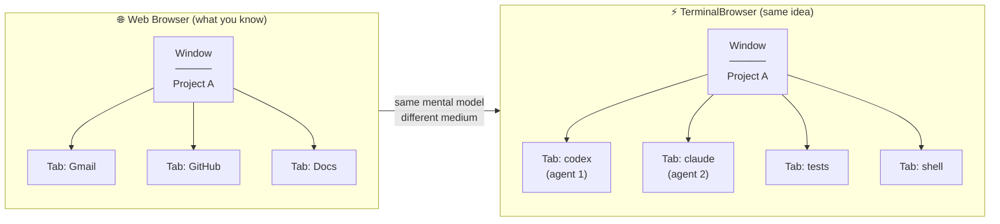
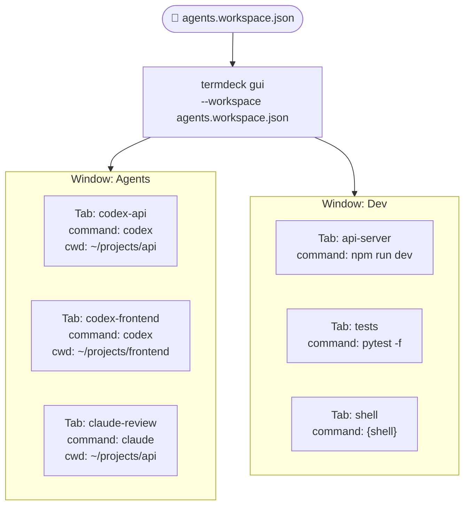
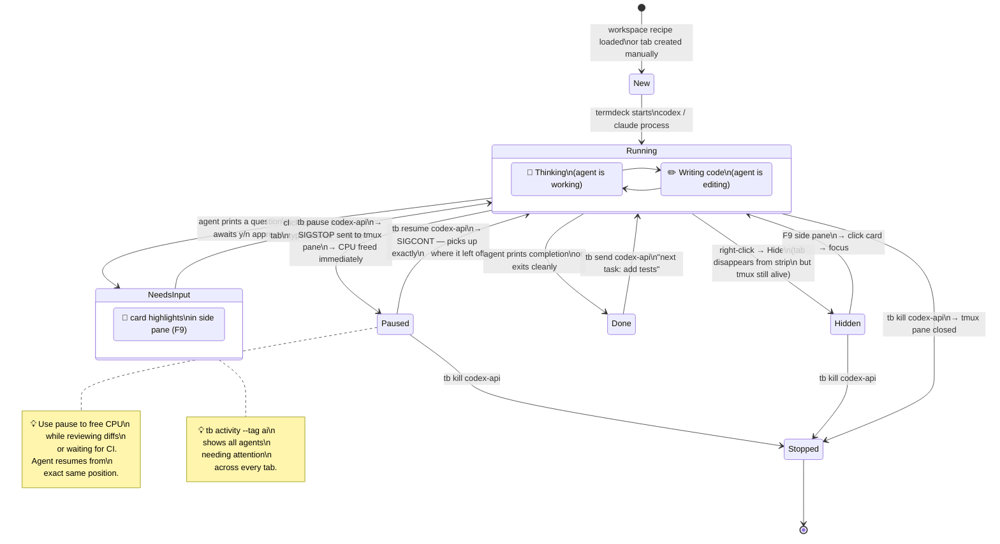
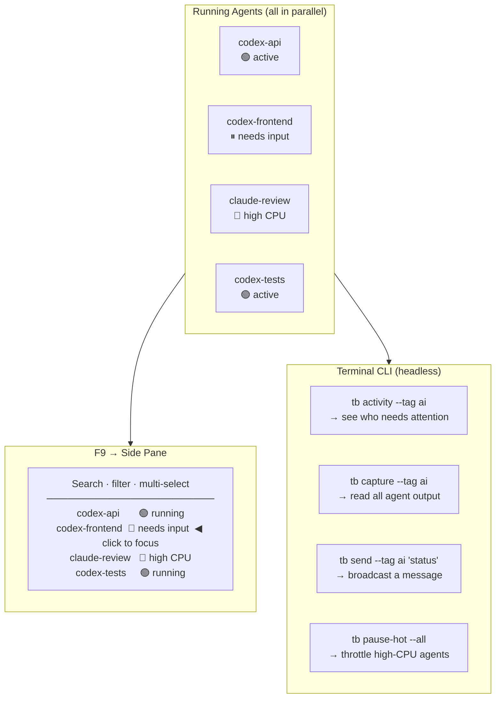
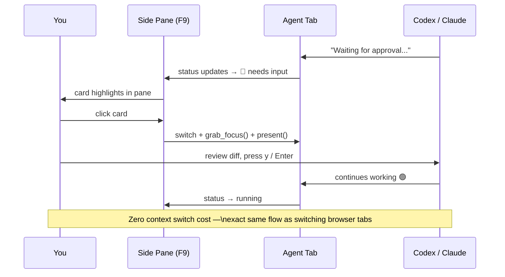
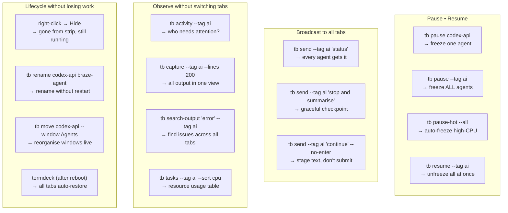

# Using TerminalBrowser with Codex / Claude Code

TerminalBrowser is purpose-built for running multiple AI coding agents in parallel. Each agent gets its own tab. You monitor, steer, and control them exactly like browser tabs — from one window.

---

## 1. The Mental Model



---

## 2. Setting Up an Agent Workspace

Create a workspace recipe file once, launch everything in one command.



**Recipe file** (`agents.workspace.json`):
```json
{
  "name": "my-project",
  "windows": [
    {
      "title": "Agents",
      "tabs": [
        {"name": "codex-api",      "tag": "ai", "command": "codex",  "cwd": "~/projects/api"},
        {"name": "codex-frontend", "tag": "ai", "command": "codex",  "cwd": "~/projects/frontend"},
        {"name": "claude-review",  "tag": "ai", "command": "claude", "cwd": "~/projects/api"}
      ]
    },
    {
      "title": "Dev",
      "tabs": [
        {"name": "api-server", "tag": "dev",   "command": "npm run dev"},
        {"name": "tests",      "tag": "tests", "command": "pytest -f"},
        {"name": "shell",      "tag": "default", "command": "{shell}", "pinned": true}
      ]
    }
  ]
}
```

---

## 3. The Agent Lifecycle

How a single Codex / Claude Code tab moves through states during a session.



---

## 4. Monitoring Multiple Agents at Once

The side pane and CLI give you a fleet view without switching tabs.



---

## 5. The Approval Loop

Codex / Claude often pauses and waits for you. TerminalBrowser makes this instant.



---

## 6. Full Day Workflow

```mermaid
gantt
    title A day of parallel agent work in TerminalBrowser
    dateFormat HH:mm
    axisFormat %H:%M

    section Morning setup
    Launch workspace recipe          :done, 09:00, 5m
    Agents start working in parallel :done, 09:05, 55m

    section Mid-morning
    codex-api needs approval         :crit, 10:00, 5m
    You review + approve via tab     :done, 10:05, 5m
    codex-frontend completes task    :done, 10:00, 30m
    Send next task to frontend agent :done, 10:30, 2m

    section Afternoon
    Pause high-CPU agents for review :done, 13:00, 10m
    Review captured output (CLI)     :done, 13:10, 15m
    Resume all agents                :done, 13:25, 5m
    All agents working               :done, 13:30, 90m

    section End of day
    Close TerminalBrowser            :done, 17:00, 1m
    Agents keep running in tmux      :active, 17:01, 59m
    Reopen tomorrow — tabs restored  :active, 18:00, 1m
```



---

## 7. Advanced Agent Controls

These are the power moves once you have multiple agents running.



---

## Quick Reference

| What you want | How |
|---|---|
| Launch all agents at once | `termdeck gui --workspace agents.workspace.json` |
| See who needs attention | `tb activity --tag ai` |
| Read all agent output | `tb capture --tag ai --lines 200` |
| Send a message to all agents | `tb send --tag ai "status"` |
| Approve in the UI | `F9` → click card → answer in terminal |
| Pause runaway agent | `tb pause claude-review` |
| Pause all high-CPU agents | `tb pause-hot --all` |
| Resume paused agents | `tb resume --tag ai` |
| Restart after reboot | `termdeck` — tabs auto-restore |
